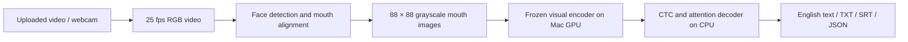

# Lip Reading Studio

## VideoMAE transfer learning — completed September 18

**Outcome: unsuccessful transcription model.** The bounded Mac experiment
completed 32 epochs over 5,000 clips, selecting epoch 24 by validation CER.
Feature extraction, training and final evaluation finished in 79.6 minutes at
18:42 EDT. Training stopped after eight epochs without a better validation score.
The frozen generic Kinetics VideoMAE encoder plus newly trained BiGRU/CTC head
produced mostly incorrect character sequences. No complete evaluation sentence
was recognized correctly. Auto-AVSR remains the default working model.

| Evaluation (200 clips per row) | VideoMAE WER | Auto-AVSR WER, same clips |
| --- | ---: | ---: |
| LRS2 validation | 112.99% | 23.08% |
| LRS3 local validation | 115.71% | 10.38% |
| LRS2 official-test subset | 117.18% | 16.41% |
| LRS3 local trainval audit | 115.34% | 8.62% |

The mean of per-dataset heldout WERs is **116.26%** for VideoMAE versus **12.51%**
for Auto-AVSR. Pooling all heldout words instead gives 115.91% versus 11.03%; these
are different aggregations. WER can exceed 100% because insertions count as errors.
The LRS3 audit is **not the official LRS3 benchmark**. These corpora appeared in
previous project experiments, and the Auto-AVSR pretrained model used LRS2/LRS3.

Training loss fell from 3.020 to 2.093, but lower training loss did not establish
useful word recognition. On validation, removing all visual features worsened
macro character error from 71.38% to 79.70%, while word error fell from 114.35%
to 101.46%. This indicates limited visual signal at the character level, not
successful transcription. This experiment does not isolate whether freezing,
feature pooling, dataset size or the decoder caused the poor outcome.

Thirty head tensors changed; the generic encoder and original Auto-AVSR weights
are unchanged. All 38 prediction reports were independently recomputed; published
weights exactly match the selected checkpoint and four raw-crop reload predictions
matched. The earlier full regression suite passed 31 checks.

An eight-second recorded example took 2.13 seconds for face tracking/recognition
and 1.37 seconds through the recorded-webcam worker after capture. Conversion,
model loading and the eight-second capture window are additional. These timings
are individual runs, not a latency guarantee. **No physical webcam was tested.**
The model remains selectable only as **VideoMAE · experimental**, with an explicit
failed-experiment warning, for reviewing the implementation. It is not recommended
for transcription. No extra training, deployment or new model campaign was started.

Full details: [experiment recipe](training/VIDEOMAE_EXPERIMENT.md),
`training/runs/videomae-v6/result.json`, `validation/videomae-completion.json`.
The reviewed ZIP includes code, weights, reports and dataset provenance; raw
LRS2/LRS3 media and feature caches are excluded.


> **Completed September 17:** Deeper fine-tuning finished 10 epochs and 15,000 updates. Validation WER improved from 21.40% to 21.06%, while test WER worsened from 16.19% to 16.25%. The app retains the pretrained model. [Full experiment results](training/DEEPER_EXPERIMENT.md). The earlier output-layer experiment is also documented below.

An English lip-reading app that runs locally on a Mac. Upload a video or use a
webcam; receive text and downloadable subtitles. Recognition uses mouth images
only. The default model is pretrained **Auto-AVSR**; a completed VideoMAE transfer-learning experiment is retained for review. Both differ from the original LipNet architecture. It is a research portfolio application, with reproducible local
fine-tuning and evaluation.

## Try it

Double-click **Start Lip Reading.command**, then open
[http://127.0.0.1:8502](http://127.0.0.1:8502).

- **Your video:** upload an MP4, MOV, WebM, AVI, MKV or MPG; click **Read this video**.
  Download TXT, SRT or JSON results.
- **Live webcam:** click **Start**, allow camera access, and face the camera.
  Click **Stop** to finish; download the transcript before starting another session.
- **Try an example:** run the included eight-second research example.
- **Model & training:** see experiment progress and measured model results.

Use one well-lit, front-facing speaker. Uploads must be 0.4–60 seconds and at most
100 MB. Keep the whole face visible and speak naturally. Recognition can miss or
invent words; review the result.

Everything stays on this Mac. The server binds to localhost, and the website has
not been deployed. The model and face detector are included; inference needs no
external service or API key.

## Live transcription and timing

Webcam text arrives **after each eight-second capture window plus processing
time**. This is segment-by-segment transcription, not instantaneous word-by-word
output. Uploads are processed in segments of up to 12 seconds. Segment boundaries
can split words, and subtitle timestamps mark segments rather than individual words.

The webcam worker keeps one waiting segment and one processing segment. When
processing cannot keep up, it reports skipped segments. Camera interruptions also
produce a visible notice. Up to 300 transcript segments are retained in memory.
Stopping the camera processes the final partial segment if it is at least 0.8 s.

A recorded eight-second example previously took 2.42 s warm or 4.81 s on the first
recognition call on this Mac's M1 Pro. Model loading and video conversion are
additional. These are one-example measurements, not a guarantee for other clips.
Current verification records are in `validation/`.

## Final MWER pilot completed — September 18

The final bounded attempt finished at **07:59 EDT**, after approximately
**76 minutes** of diagnosis, training and evaluation. Both conventional training
and MWER completed **two full epochs and 250 updates each** on the same 1,000
training clips, with identical initialization and data order. Each arm updated
26,670,450 decoder/CTC parameters; the visual encoder stayed frozen.

### Validation results (400 clips, 200 per dataset)

| Model | LRS2 WER | LRS3 WER | Mean of dataset WERs | Total word errors |
| --- | ---: | ---: | ---: | ---: |
| Pretrained, beam 20 | 25.83% | 10.99% | 18.41% | 638 |
| Conventional, epoch 1 | 25.83% | 10.76% | 18.29% | 633 |
| Conventional, epoch 2 | 25.51% | 10.58% | 18.04% | 624 |
| MWER, epoch 1 | 25.83% | 10.85% | 18.34% | 635 |
| MWER, epoch 2 | 25.57% | 10.67% | 18.12% | 627 |

**Outcome:** MWER corrected 11 word errors overall, reducing mean WER by **0.289
percentage points**. The matched conventional-training control corrected 14,
reducing mean WER by **0.367 points**. MWER did not outperform the control.
Neither met the predefined 0.50-point improvement requirement. No candidate was
selected, and the conditional additional audit/test evaluations were not run.
These results do not establish an improved test model.

The diagnostic found a better candidate among the top ten token sequences for
160 of 400 clips. Choosing candidates with the reference answers gave **11.32%
mean WER**, versus 18.41% for actual top-ranked predictions. This is an oracle
score: it uses the answers and is NOT deployable model accuracy. The diagnostic
supported trying ranking-focused training, but the pilot captured little of that
potential. The result does not prove that all possible MWER recipes would fail.

Conventional training loss decreased from 3.509 to 3.206. MWER's centered
objective decreased from −0.249 to −0.328; negative values are expected because
candidate error counts are centered. Loss values across these different
objectives are not directly comparable.

The app retains the original pretrained weights and fast beam-5 decoding.
Its previously measured **16.19% LRS2 test WER** is unchanged. All pilot comparisons
use beam 20 and a different validation subset, so their numbers must not be
compared directly with that test score or the larger experiment-4 validation.

**This completed the Auto-AVSR training attempts.** A separate VideoMAE transfer-learning experiment was subsequently authorized; its status is above. No deployment is planned. The app remains usable locally,
and all candidate checkpoints, split provenance, predictions and experiment
code are retained for review. Dataset media is excluded from the app archive.

## MWER verification and uncertainty

All five evaluation reports and the candidate-oracle score were independently
recomputed. Reloading all four epoch checkpoints reproduced eight recorded
predictions (one per dataset per checkpoint). Every targeted module changed,
and the original checkpoint hash remained intact.

A paired bootstrap over recording sessions (2,000 repetitions, stratified by
dataset) estimated these 95% intervals for **mean WER reduction**, in percentage
points:

- Conventional versus pretrained: **+0.053 to +0.743** (estimate +0.367).
- MWER versus pretrained: **+0.017 to +0.600** (estimate +0.289).
- MWER versus conventional: **−0.405 to +0.203** (estimate −0.078).

The first two intervals support small gains on this validation sample. They do
not remove bias from choosing the better epoch on the same validation data, or
establish unseen-speaker/test improvement. The comparison between methods gives
no evidence that MWER is superior. The predefined minimum gain was not met, so
we preserve the original app model and finish the attempt as requested.

All 26 regression tests passed before the run; the active recognition pipeline
is unchanged. Previously verified upload/WebRTC throughput therefore remains the
relevant runtime evidence. No candidate was activated or deployed.

## Completed mixed-data fine-tuning — September 18

Experiment 4 finished at **00:47 EDT**, after approximately **7 hours 41 minutes**
including baseline evaluation, feature preparation, training and final evaluation.
It completed **three full epochs, 14,304 optimizer updates**, and **228,846 clip
presentations** using 76,282 training clips (45,814 LRS2 + 30,468 verified LRS3).
The preset early-stopping rule ended the run because no epoch qualified; six
was the maximum, not a promise to continue after the stopping condition.

| Validation measure | Pretrained, beam 20 | Epoch 1 | Epoch 2 | Epoch 3 |
| --- | ---: | ---: | ---: | ---: |
| LRS2 WER, 1,082 clips | 22.883% | 22.960% | 23.023% | 22.921% |
| LRS3 WER, 1,488 clips | 8.744% | 8.577% | 8.421% | 8.380% |
| Mean of dataset WERs | 15.814% | 15.768% | 15.722% | 15.651% |
| Training loss | — | 4.024 | 3.837 | 3.733 |

**Outcome:** the final epoch reduced LRS3 word errors by 63 (1,515 → 1,452), but
added three LRS2 errors (1,800 → 1,803). Mean WER improved by **0.163 percentage
points**, below the required 0.50-point gain, and every epoch regressed on LRS2
WER. No adapted checkpoint qualified. The app keeps the original pretrained
weights. The final trained weights and optimizer state are saved in `last.pt`;
there is no eligible `best.pt` for this run.

All five mixed-data evaluation reports and all 14 decoding reports were
independently rescored. Saved weights changed in every targeted module, and
reloading the final checkpoint reproduced four recorded validation predictions
(two from each dataset). The original checkpoint hash is unchanged.

No adapted test evaluation was run because no validation candidate qualified.
The **16.14%** LRS2 test WER in experiment 4 is the unchanged pretrained model
with beam 20. The active app keeps faster beam 5, whose measured LRS2 test WER
is **16.19%**. The small decoding difference must not be attributed to training.

LRS3 validation comes from the approximately 30-hour trainval release, held out
of local fine-tuning. The base model already trained on LRS3. Its sub-10% WER on
this partition is neither a new official benchmark nor evidence of sub-10% WER
on personal webcam recordings. The goal of a robust overall improvement over
the pretrained model remains unmet. Experiment 4 is finished; see the latest status above for subsequent work.

## Final runtime checks

On the included eight-second video, two uploads including normalization, face
tracking and recognition took **4.47 / 3.03 seconds with beam 5**, versus
**4.72 / 4.67 seconds with beam 20**. Model loading is excluded.
Two paced eight-second webcam windows per decoder processed in **2.13 / 2.10
seconds with beam 5** and **3.82 / 4.41 seconds with beam 20**, with zero skipped
windows. This is a recorded-video throughput check, not a physical-camera test
or a guarantee for other speakers. Timing details are in
`validation/decoding-throughput.json`. The faster beam-5 default is retained.

## Completed decoding and data expansion — experiment 3

Wider search and the authors' external English language model are implemented
and evaluated. The external-LM finalist failed the predefined character-error
condition. Beam 20 without LM was selected on 500 validation clips before test
and cross-dataset audits. Compared with beam 5, it removed three word errors on
1,243 LRS2 test clips, and one error on each additional validation subset. Extra
LRS2 character error worsened. Prepared-crop test processing averaged 0.31 seconds
with beam 5 and 0.48 seconds with beam 20. These small differences do not justify
replacing the faster app default. Both configurations remain reproducible in code.

Combined data acquisition and independent label verification are complete.
One LRS3 clip missing from the author label list was excluded; verified manifests
contain 76,282 training, 2,570 validation and 1,243 test clips. Dataset provenance,
IDs and hashes are published with this project; dataset media stays outside the
application package. See `training/combined-data-provenance.json`.

## Earlier output-layer training and accuracy

The base checkpoint has 250,383,410 parameters and was trained by the Auto-AVSR
authors. The local adaptation experiment updates 7,765,362 parameters in its CTC
and attention output layers while freezing the visual encoder and decoder body.

The experiment uses real transcribed **LRS2 mouth-crop videos**: 4,000 training,
500 validation and 1,243 test clips. Source revisions, download hashes, exact
selection rules and split checks are recorded in `training/data-provenance.json`.
Validation selects the model before test evaluation. The unchanged pretrained
model remains available, and a weaker adaptation is not automatically installed.

The completed run trained three full epochs and 1,500 optimizer updates. It did
not improve validation word error, so the app keeps the original pretrained
model. That model measured **16.19% word error**, **10.24% character error** and
**728/1,243 exact transcripts** on the prepared-mouth LRS2 test split, with no
failed examples. See [the review report](REVIEW.md), [training instructions](training/README.md)
and `training/runs/lrs2-heads-v1/result.json`.

Prepared-mouth benchmark results do **not** measure the app's face tracker or
establish accuracy on arbitrary webcam recordings. The base checkpoint already
trained on LRS2. This project makes no unseen-speaker generalization claim and
does not present the authors' published benchmark score as its own measurement.
The earlier GRID/LipNet experiments are preserved in sibling workspace folders
but are not required by this app.

## Architecture



FFmpeg removes uploaded audio and normalizes rotation, size and frame rate.
MediaPipe detects facial landmarks. The author's alignment produces 96×96 RGB
mouth images; the app center-crops to 88×88, converts to grayscale and applies
the author's normalization. The visual encoder uses Apple MPS when available.
Beam search runs on CPU with width five for interactive speed. The reference
research decoder uses a wider beam, so published results are not directly interchangeable.

## Setup on another machine

Tested on Apple Silicon macOS with Python 3.13 and FFmpeg. Install Python and
FFmpeg, then run:

```sh
./setup.sh
.venv/bin/python -m streamlit run app.py --server.address 127.0.0.1 --server.port 8502
```

GPU selection prefers CUDA, then Apple MPS, then CPU. CPU-only execution is slower.

```sh
# Command-line transcription
.venv/bin/python -m studio my-video.mp4 --output my-results

# Regression tests
.venv/bin/python -m pytest -q

# Recorded video over local WebRTC, without physical camera access
.venv/bin/python validation/check_webrtc.py
```

Training has additional dependencies in `training/requirements.txt`. Dataset
videos and feature caches are intentionally outside the application package.

## Privacy and limitations

- Upload audio is discarded before recognition; webcam microphone capture is disabled.
- Upload working files are deleted after processing. Uploaded bytes and results
  may remain in the current Streamlit session until cleared or the session ends.
- Webcam frames stay in memory and are not recorded to disk. Both WebRTC peers
  are local, with no external ICE servers.
- Multiple visible faces, very small faces and unreliable tracking are rejected.
- Physical camera capture and recognition of your own speech require a manual
  check with browser/macOS permission. Recorded-video WebRTC testing exercises
  transport, buffering and recognition without claiming a physical-camera test.

## Sources

- [VideoMAE source and model zoo](https://github.com/MCG-NJU/VideoMAE)

- [Auto-AVSR authors' source and checkpoints](https://github.com/mpc001/auto_avsr)
- [Auto-AVSR paper](https://arxiv.org/abs/2303.14307)
- [LRS2 dataset overview](https://www.robots.ox.ac.uk/~vgg/data/lip_reading/)
- [Training distribution](https://huggingface.co/datasets/MahmoodAnaam/LRS2-Train)
- [Validation distribution](https://huggingface.co/datasets/MahmoodAnaam/LRS2-Validation)
- [Test distribution](https://huggingface.co/datasets/MahmoodAnaam/LRS2-Test)
- [Original LipNet tutorial](https://github.com/nicknochnack/LipNet)
- [Original LipNet paper](https://arxiv.org/abs/1611.01599)
- [Included example's AV-HuBERT source](https://github.com/facebookresearch/av_hubert)

VideoMAE source and pretrained weights retain **CC-BY-NC-4.0** terms; see
`vendor/videomae/LICENSE` and `models/videomae-provenance.json`.

Vendored Auto-AVSR/ESPnet source retains its Apache-2.0 license and notices. Model
hashes and the source revision are in `models/provenance.json`. Checkpoint and
media terms may derive from the original datasets; this project does not establish
commercial deployment rights. Downloaded LRS2 videos are not redistributed in the app.

## Final verification

The current suite has **31 passing regression checks** (including two face-tracker checks rerun with macOS GPU access). The local WebRTC transport test received 200
video frames with no audio tracks or skipped segments. The completed results
panel was checked in the browser. Checkpoint, independent metric, runtime and
UI evidence are retained in `validation/`. Physical-camera testing remains a
manual review step. No website was deployed.
